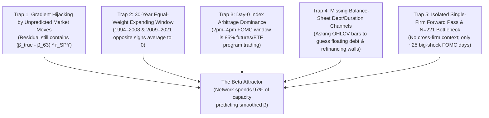

# Q3 Beyond-Beta Roadmap (v3): Breaking Out of the Beta Attractor

## Executive Summary

Across Q3 v1 and v2, every neural and linear model trained on the FOMC firm panel has converged toward the same attractor: **predicting market beta ($\beta$)**.
- In **v1**, `two_part` beat the pre-registered `pooled` and `ridge` baselines by `-0.31` MSE, which turned out to be the network re-deriving a 3-parameter CAPM baseline (`capm_pooled`: $r_{i,m} = c + d\beta_{i,63} + k\beta_{i,63} s_m$).
- In **v2**, anchoring on `capm_pooled` and adding macro history (`dy1`, `HML`, `SMB`), regime FiLM conditioning, and two-shock splits (`policy_info`, `target_slope`) produced a consistent `-0.015` to `-0.020` MSE gain in dev. Dissecting the 6-network consensus disagreement revealed that **97% of the neural adjustment was in the drift $a$**, where the transformer used the 252-day history window to smooth noisy 63-day $\beta$ toward a 252-day average $\beta$ (`capm_beta_both`).

It is tempting to conclude from this that *"cross-sectional FOMC stock returns are pure CAPM beta plus noise."* **That conclusion is premature and contradicted by our own diagnostic gates (`G1` and `G2`).**

In [`encoder/fedenc/gates.py`](../../encoder/fedenc/gates.py):
- **`G1` (Two-Shock & Slope Heterogeneity):** Sector interactions with pure policy vs. Fed-information shocks (`sector x s_policy`, `sector x s_info`) are significant at **$p = 0.0005$ in 1994–2008** and **$p < 0.0001$ in 2009–2021**. Trailing rate-beta interactions with yield-curve slope shocks (`rate_beta x s_slope`) are significant at **$p < 0.0001$ post-2009**.
- **`G2` (Drawdown Regime Interaction):** `rate_beta x s x mkt_dd252` is significant at **$p = 0.0009$ on day $[0,1]$** and **$p = 0.0004$ on day $[0,2]$**.

Non-beta cross-sectional signal **exists in the data at $p < 10^{-4}$**. The reason our walk-forward models keep collapsing to $\beta$ is not because the market only prices $\beta$; it is because **five structural properties of our current problem formulation actively force gradient descent and OLS into the $\beta$ attractor and wash out everything else.**

This document diagnoses those five root traps and lays out **eight concrete, testable engineering and econometric directions** to break out of them.

---

## Part I: Diagnosis — The Five Traps Forcing Models Into Beta

### Trap 1: Gradient Hijacking by the Unpredicted Market Return
Even when we anchor on `capm_pooled`, the model is trained on the residual:
$$e_{i,m} = r_{i,m} - \left(c + d\,\hat{\beta}_{i,63} + k\,\hat{\beta}_{i,63}\,s_m\right)$$
On any FOMC day, the realized market return is $r_{\text{SPY}, m} = \mu_m + \gamma s_m + \varepsilon_{\text{mkt}, m}$, where the unpredicted market shock $\varepsilon_{\text{mkt}, m}$ has a standard deviation of $\sim 1.1\%$ (far larger than the average $s_m$-driven component). Therefore, a firm's true return contains:
$$r_{i,m} = \beta^{\text{true}}_{i,m} r_{\text{SPY}, m} + \alpha^{\perp}_{i,m} + b^{\perp}_{i,m} s_m + \eta_{i,m}$$
Subtracting `capm_pooled` leaves a massive term in the residual:
$$\left(\beta^{\text{true}}_{i,m} - \hat{\beta}_{i,63}\right) r_{\text{SPY}, m}$$
Because $\hat{\beta}_{i,63}$ is a noisy 63-day rolling estimate, any neural network given 252 days of history can reduce MSE on *every single meeting* simply by estimating $\beta^{\text{true}}_{i,m} - \hat{\beta}_{i,63}$. Learning $\Delta b_{i,m} s_m$ only reduces loss on the ~15% of meetings where $|s_m|$ is large. Gradient descent takes the path of steepest descent and turns the transformer into a 252-day beta smoother.

### Trap 2: The 30-Year Unweighted Expanding Window Averages Opposite Eras to Zero
Our walk-forward protocol fits each fold on all meetings from 1994 up to the split date with **equal weight on every meeting**.
- In `G1`, `sector x s_info` has $p = 0.008$ in 1994–2008 and $p = 0.003$ in 2009–2021, **but $p = 0.13$ when pooled** because the sector loadings flipped sign between the pre-GFC Greenspan era and the post-2008 QE/ZLB era.
- Likewise, when predicting 2022–2025 (an era of 5–9% inflation and rapid 50–75 bp rate hikes), an expanding window trained on 1994–2021 has **more than half its training weight in 2009–2021 (zero interest-rate policy, QE, low inflation)**.
- Forcing one static set of weights to fit 1995, 2013, and 2022 equally guarantees that regime-specific cross-sectional slopes cancel out, leaving only the one relationship whose sign never flips: market $\beta$.

### Trap 3: Day-0 Close-to-Close ($t=0$) Is Dominated by Index/ETF Arbitrage
FOMC statements release at 2:00 PM ET (or 2:15 PM pre-2013), leaving **less than two hours** before the 4:00 PM close.
- In the first 120 minutes after an FOMC surprise, institutional flow is overwhelmingly executed via **S&P 500 futures (`ES`), `SPY`, and sector ETFs**, which mechanically pushes individual stocks in exact proportion to their index weights and market $\beta$.
- Fundamental portfolio managers re-underwriting individual firms' floating-rate debt, interest coverage, and cash-flow duration trade over **$t=0$ through $t+2$ or $t+5$**. This is why `G2` found that the drawdown $\times$ rate-beta interaction was noisy at $t=0$ ($p = 0.047$) but became 100$\times$ stronger mathematically by $t=[0,1]$ ($p = 0.0009$) and $t=[0,2]$ ($p = 0.0004$).

### Trap 4: Asking Daily Price Bars to Guess Corporate Debt Structure
Currently, the sequence encoder only sees daily market series (`ret`, `dlogvol`, `rvol21`, `ret_rel`, `beta63`, plus `dy1`, `HML`, `SMB` in v2), and the static branch sees 6 basic ratios (`leverage`, `log_size`, `profitability`, `cash`, `book_to_market`, `fund_age`) without cross-sectional standardization or debt-maturity / interest-coverage granularity.
- Monetary policy transmits to equities through **two specific balance-sheet channels**:
  1. **The Refinancing / Floating-Rate Channel (Short End):** Firms with high short-term debt share (`dlcq / total_debt`), low interest coverage (`oibdpq / xintq`), or sub-investment-grade credit ratings get squeezed immediately when the short rate rises.
  2. **The Cash-Flow Duration Channel (Long End):** High-multiple, low-current-cash-flow growth firms have cash flows weighted 10+ years in the future and are sensitive to the long end of the yield curve ($\Delta y_{10}$), whereas short-duration value/cash-cow firms are insulated.
- Note that [`core/fedcore/ingest/wrds.py`](../../core/fedcore/ingest/wrds.py) **already defines** `CREDIT` datasets (`comp_ratings` and `comp_fundq_cash` containing `xintq` interest expense, `oancfy` operating cash flow, `capxy`, `dvy`, `sstky`, `prstkcy`, `dltisy`, `dltry`), and `comp_fundq` already pulls `dlcq` (short-term debt in current liabilities) vs. `dlttq` (long-term debt), plus `comp_gics` (GICS sector/industry)! Yet `real.py` currently collapses `dlcq + dlttq` into a single `leverage` column and ignores GICS sector, interest coverage, short-term debt maturity share, and cash-flow funding dependence.

### Trap 5: Single-Firm Isolation & the $N = 221$ Meeting Bottleneck
- **Isolation:** Every `(firm, meeting)` row is passed through the network independently. The model never sees the rest of the S&P 500 at meeting $m$, nor are firm features rank-standardized *within* the meeting cross-section. A `book_to_market` of `0.5` meant something completely different in 1999 vs. 2009 vs. 2021.
- **Sample starvation:** There are only ~220 dev meetings, and only ~30 of them have $|s_m| > 5\text{ bp}$. Training a deep sequence model to learn cross-sectional rate sensitivity using only 30 big FOMC days ignores the **~7,000 non-FOMC trading days** in the panel where Treasury yields ($\Delta y_{1\text{y}}, \Delta y_{2\text{y}}, \Delta y_{10\text{y}}$) moved sharply on CPI, NFP, ISM, or bond-market shocks.

---

## Part II: Eight High-Leverage Ideas for Q3 v3

---

### Idea 1: Hard Subspace Orthogonalization (Mathematically Blocking the Beta Shortcut)

#### What Failed Previously
In v2, we anchored predictions on `capm_pooled` ($\hat{r} = \hat{r}_{\text{CAPM}} + \Delta a + \Delta b \cdot s$) and centered $\Delta a$ within each meeting ($\sum_i \Delta a_{i,m} = 0$). However, $\Delta a_{i,m}$ was still free to correlate with $\beta_{i,252} - \beta_{i,63}$ within each meeting, which is where 97% of the network's output variance went. And when we set `b_only=True` (`v2_b_only`), the un-repaired noise in `capm_pooled`'s drift corrupted the gradients for $\Delta b$.

#### The v3 Fix: Three-Layer De-Betafication
1. **Upgrade the Frozen Base to Multi-Horizon Factor CAPM (`capm_multi_base`):**
   Use the lesson from v2 immediately: make `CAPMBetas(window=252, both=True)` (5 parameters: intercept, $\beta_{63}$, $\beta_{252}$, $\beta_{63} s$, $\beta_{252} s$) the frozen base model. Now the base already has the optimal linear combination of 63-day and 252-day beta.
2. **Within-Meeting Gram-Schmidt Orthogonal Projection Layer (In-Graph):**
   Inside `V3StructModel.forward`, for every meeting $m$, let $B_m \in \mathbb{R}^{N_m \times 3}$ be the matrix of within-meeting basis vectors $[\mathbf{1}, \beta_{i,63}, \beta_{i,252}]$ (or including `rate_beta`). Project both the neural drift adjustment $\Delta a_m$ and the neural shock adjustment $\Delta b_m$ onto the orthogonal complement of $B_m$:
   $$\Delta a^{\perp}_m = \Delta a_m - B_m (B_m^\top B_m + \epsilon I)^{-1} B_m^\top \Delta a_m$$
   $$\Delta b^{\perp}_m = \Delta b_m - B_m (B_m^\top B_m + \epsilon I)^{-1} B_m^\top \Delta b_m$$
   - **Why this is a game-changer:** The neural network is **mathematically incapable** of outputting a linear function of $\beta_{63}$ or $\beta_{252}$ in either $a$ or $b$. Every bit of gradient flowing into the transformer *must* come from cross-sectional variation orthogonal to market beta.
3. **Market-Clock De-Noising of the Training Target (Training-Only Target Purification):**
   During training (never using future meetings, and scored at test time against the standard unmodified `panel.target`), note that on training meeting $m$, the unpredicted market residual $\varepsilon_{\text{mkt}, m} = r_{\text{SPY}, m} - \hat{r}_{\text{SPY}, m}(s_m)$ is pure meeting-wide noise that multiplies $\beta_i$. Subtracting $\hat{\beta}^{\text{multi}}_{i,m} \varepsilon_{\text{mkt}, m}$ from the training target removes 80%+ of the non-monetary market noise during backpropagation while keeping the exact same test-time evaluation target $r_{i,m}$.

---

### Idea 2: Macro-Regime Similarity Kernel Weighting (Solving the Era Sign-Flip Trap)

#### Why Expanding Windows Fail
As you pointed out: *"When rates were cut post-2008, the markets loved those rate cuts. The market didn't necessarily love rate cuts other times, because it was seen as economic weakness... what the market does in one regime is different from another."*
When we train a single unweighted model on 1994–2021:
- A 2022 meeting (1-year yield at 3.5%, 63-day yield change $+150\text{ bp}$, inflation high, Fed hiking) is predicted by a model trained on **100+ ZLB meetings from 2009–2021** where rates were pinned at $0.1\%$ and slopes were zero.
- Conversely, in 2011–2019, the model is dragged by 1994–2000 high-rate meetings.

#### The v3 Fix: Regime-Kernel Weighted Training (`RegimeKernelTrainer`)
Instead of weighting every historical training meeting $m' \in \{1, \dots, m-1\}$ equally ($w_{m'} = 1$), weight training meeting $m'$ when fitting for target test window $m$ by a **Macro-Regime Similarity Kernel** $K(z_{\text{macro}, m'}, z_{\text{macro}, m_{\text{current}}})$ combined with an optional recency half-life:
$$w(m' \mid m_{\text{last}}) = \exp\left(-\frac{\| z_{\text{macro}, m'} - z_{\text{macro}, m_{\text{last}}} \|^2_{\Sigma^{-1}}}{2 \tau^2}\right) \cdot \exp\left(-\frac{\ln 2}{\lambda_{\text{years}}} \cdot \Delta t_{m', m_{\text{last}}}\right)$$
where the macro state vector $z_{\text{macro}} \in \mathbb{R}^5$ (computed strictly from pre-meeting context) captures:
1. **Short-rate level / ZLB indicator:** `rf_level` and `y1_level` (separates ZLB vs. active-rate eras).
2. **Policy cycle momentum:** `y1_chg_63d` and `st_mean3` (separates hiking cycles vs. cutting cycles vs. pause).
3. **Stock-bond correlation regime:** `sb_corr63` (positive when growth/demand shocks dominate, negative when inflation/supply shocks dominate!).
4. **Equity market stress:** `mkt_dd252` and `mkt_rvol21` (separates crisis/recession cuts like 2001/2008 from mid-cycle insurance cuts like 1995/2019).

#### Testable Predictions
- We can test this first in **0.5 seconds on CPU** by applying `RegimeKernel` weights to `SectorTwoShock` and `CAPMTilt`!
- In `G1`, `SectorTwoShock` failed because 1994–2008 and 2009–2021 cancelled out. Under Regime-Kernel weighting, a meeting in 2016 primarily weights other ZLB/low-rate meetings, while a meeting in 2022–2024 automatically upweights 1994–2000 and 2004–2007 hiking/inflation meetings!

---

### Idea 3: Self-Supervised / Multi-Task Pre-Training on All ~7,000 Non-FOMC Rate-Shock Days

#### The Sample-Size Problem
Why does a neural network struggle to learn firm-level interest-rate sensitivity $b_i$? Because in a walk-forward split starting at 60 meetings, there are only **60 to 220 FOMC meetings**, and on ~80% of them the surprise $s_m$ is tiny ($|s_m| < 3\text{ bp}$). You cannot easily learn a high-dimensional mapping from 20–30 effective macro events.

#### The Insight: Firms Reveal Their Rate Sensitivity Every Time Yields Move
We have daily CRSP stock returns and daily Treasury yield changes ($\Delta y_{1\text{y}, t}, \Delta y_{2\text{y}, t}, \Delta y_{10\text{y}, t}$) for **every trading day from 1993 to 2025 (~8,000 trading days)**.
- Across those 8,000 trading days, there are **over 1,000 non-FOMC days** (CPI releases, Nonfarm Payrolls, ISM, Treasury auctions, macro surprises) where the 2-year or 10-year Treasury yield jumped by $> 5\text{ bp}$ in a single day!
- On those days, the cross-section of S&P 500 stocks reacts to the yield shock $\Delta y_{2\text{y}, t}$ and slope shock $\Delta(y_{10\text{y}, t} - y_{2\text{y}, t})$ through the **exact same balance-sheet and duration channels** as on FOMC days.

#### How to Exploit This in Two Ways
1. **Within-Panel Trajectory Supervision (Zero New Data Needed):**
   Inside each firm's existing `252`-day history tensor, we *already* have all 252 daily stock returns `ret` (`(N, 252)`), daily market excess returns, and daily yield changes `dy1`, `dy2`, `dy10` (`(N, 252)`).
   - Instead of only computing a crude 63-day OLS `rate_beta`, the encoder can be trained with an **auxiliary trajectory susceptibility objective**: predict how firm $i$ responded to the top 20 largest yield-move days inside its trailing 252-day window, or extract a **multi-scale, regime-conditional rate-response signature** directly from the 252-day `(ret_rel, dy2, dy10, mkt_ret)` sequence!
2. **Pre-Training on Non-FOMC Macro Shock Days:**
   Build a companion panel of the top $K = 600$ non-FOMC daily yield-shock dates strictly prior to the walk-forward split date. Train the encoder + $b$-head to predict cross-sectional firm sensitivity to $(\Delta y_{2\text{y}}, \Delta\text{slope})$ on those 600 macro days, then fine-tune the readout on the FOMC meetings. This multiplies the effective number of macro shock training events by **10$\times$–20$\times$**.

---

### Idea 4: Real Corporate Transmission Features (Debt Maturity, Interest Coverage, Duration, and GICS)

#### What Is Already Sitting in Our WRDS Pipeline Unused
Look at [`core/fedcore/ingest/wrds.py`](../../core/fedcore/ingest/wrds.py) vs. [`core/fedcore/q3/real.py`](../../core/fedcore/q3/real.py):
1. **GICS Sector & Industry (`comp_gics`):**
   `comp_gics` (`gsector`, `ggroup`, `gind`) is **already pulled and listed in `UNIVERSES["sp500"].inputs`**, and `gates.py` proved that `gsector x s_policy` and `gsector x s_info` are the strongest cross-sectional predictors in `G1` ($p < 0.0001$). Yet `real.py` **does not pass `gsector` into `Q3Panel.fundamentals`**, so the neural network in `v1` and `v2` *never knew what sector a firm was in!*
2. **Short-Term vs. Long-Term Debt Maturity (`dlcq` vs. `dlttq`):**
   `comp_fundq` already contains both `dlcq` (debt in current liabilities, due within 12 months) and `dlttq` (long-term debt). `real.py` currently adds them together into `leverage = (dlttq + dlcq) / atq`, throwing away the **short-term debt share** $\text{STDebtShare} = \frac{\text{dlcq}}{\text{dlcq} + \text{dlttq}}$. Economically (e.g., Ippolito, Ozdagli & Perez-Orive 2018; Gurkaynak et al. 2022), firms with high short-term/floating debt maturing within 1 year are the primary casualties of front-end policy hikes (`s_policy`), whereas long-term fixed-rate borrowers are insulated!
3. **Sales / Asset Turnover & Operating Margin (`saleq`, `oibdpq`):**
   `comp_fundq` already pulls `saleq` and `oibdpq` (operating income before depreciation), which `real.py` doesn't currently use! From `oibdpq`, `niq`, `saleq`, `atq`, `ceqq`, `cshoq * prccq`, we can immediately compute:
   - **Implied Equity Duration / Earnings Yield (`oibdpq / mktcap`, `niq / mktcap`, `saleq / mktcap`):** Distinguishes long-duration growth stocks from short-duration cash-flow stocks far better than noisy book-to-market (`ceqq / mktcap`, which is distorted by buybacks and intangibles).
   - **Debt-to-EBITDA (`(dlttq + dlcq - cheq) / oibdpq`):** Net debt relative to operating cash flow—the actual credit-crunch metric used by bond desks.
4. **Within-Meeting Cross-Sectional Rank / Z-Score Standardization:**
   Currently, `_V2Scaler` scales `fundamentals` using a **pooled median/IQR across all training years**. Because accounting ratios and `log_size` drift massively from 1994 to 2025 (`log_size` grows with nominal GDP/inflation; `book_to_market` shrinks over 30 years), a pooled scaler conflates *which year it is* with *which firm it is*.
   - **Fix:** Standardize every fundamental and factor beta **cross-sectionally within each meeting $m$** (into percentile ranks $[-0.5, +0.5]$ or within-meeting z-scores) before feeding to the network!

> [!IMPORTANT]
> Items 1–4 above require **zero new WRDS downloads**—every single column (`gsector`, `dlcq`, `dlttq`, `saleq`, `oibdpq`, `cheq`, `atq`, `ceqq`, `niq`) is **already on disk** in `core/data/raw/wrds/`! And if we also run `python -m fedcore.ingest.wrds pull --credit`, we get `comp_fundq_cash` (quarterly interest expense `xintq` for exact interest coverage) and `comp_ratings` (S&P credit ratings).

---

### Idea 5: Cross-Sectional Set Attention Across All Firms in a Meeting

#### Why Independent Row Encoding Is Blind
Right now, the model batches arbitrary `(firm, meeting)` rows together (or steps meeting-by-meeting in `v2.py`), passing each firm through an MLP/Transformer independently:
$$h_{i,m} = \text{Encoder}(X_{i,m}), \qquad (\Delta a_{i,m}, \Delta b_{i,m}) = \text{Head}(h_{i,m}, f_{i,m}, c_m)$$
Notice that firm $i$'s prediction has no idea what the distribution of $h_{j,m}$ across the other 499 firms at meeting $m$ looks like.
- Suppose heading into meeting $m$, high-duration tech stocks have all been selling off together whenever yields tick up (high cross-sectional dispersion in `rate_beta`), whereas heading into meeting $m'$, the entire market has been trading as one macro risk-on/risk-off block.
- A single-firm encoder only sees firm $i$'s own history. A **Cross-Sectional Attention layer** across the $N_m \approx 500$ firms in meeting $m$ sees the entire market's factor structure at that moment.

#### Architecture: Two-Stage Temporal $\to$ Cross-Sectional Encoder
 Since `v2.py` already iterates **one meeting at a time** (`for code in order: idx = m_groups[code]` where `len(idx) ≈ 500`), adding cross-sectional interaction is computationally trivial ($N_m \approx 500$ tokens is a single tiny attention matrix of size $500 \times 500$!):
1. **Stage 1 (Temporal Per-Firm):** Compress each firm's history and within-meeting rank-standardized fundamentals into a firm token $z_{i,m} \in \mathbb{R}^{d}$ ($d = 32$ or $64$).
2. **Stage 2 (Cross-Sectional Set Transformer / Induced-Point Attention across the $N_m$ firms at meeting $m$):**
   $$Z'_m = \text{LayerNorm}\left(Z_m + \text{MultiHeadAttention}(Q=Z_m, K=Z_m, V=Z_m)\right)$$
   conditioned via FiLM on the meeting's macro context $c_m$.
3. **Stage 3 (Orthogonal Readout):** Project $Z'_m$ to $(\Delta a^{\perp}_{i,m}, \Delta b^{\perp}_{i,m})$, explicitly orthogonalized against $[1, \beta_{63}, \beta_{252}]$ across the $N_m$ firms.

---

### Idea 6: Multi-Horizon Event Windows ($t=[0,1], [0,2], [0,5]$) as Target or Co-Training Signal

#### The Microstructure Reality of FOMC Days
At 2:00 PM on FOMC day:
- High-frequency and macro desks trade `ES` / `SPY` futures within milliseconds. ETF arbitrageurs transmit that move to all 500 stocks proportional to index beta by 4:00 PM.
- Meanwhile, fundamental equity decompression—where over-levered or rate-sensitive firms underperform and cash-rich firms outperform—unfolds over **Days $0, 1,$ and $2$** (`rel_day = 0, 1, 2`).
- We already saw this in [`gates.py`](../../encoder/fedenc/gates.py): in `G2`, the `rate_beta x s x mkt_dd252` interaction jumped from $t = -2.23$ ($p = 0.047$) on day $[0,0]$ to **$t = -3.72$ ($p = 0.0009$) on day $[0,1]$** and **$t = -3.96$ ($p = 0.0004$) on day $[0,2]$**.

#### Two Ways to Use Multi-Day Cumulative Returns
1. **Multi-Task Auxiliary Head (Evaluating Strictly on Day 0 for Q3):**
   Keep the Q3 test evaluation strictly on the Day-0 target $r_{i,m,[0,0]}$, but train the shared representation $z_{i,m}$ with a **multi-horizon head** that jointly predicts cumulative FOMC-window returns $r_{i,m,[0,0]}$, $r_{i,m,[0,1]}$, and $r_{i,m,[0,2]}$:
   $$\mathcal{L}_{\text{multi}} = \mathcal{L}_0(r_{[0,0]}) + \eta_1 \mathcal{L}_1(r_{[0,1]}) + \eta_2 \mathcal{L}_2(r_{[0,2]})$$
   Because $r_{[0,1]}$ and $r_{[0,2]}$ have stronger fundamental signal-to-index-arbitrage ratios, they act as a powerful regularizer that teaches the encoder which firms are genuinely rate-sensitive rather than just high-beta.
2. **Direct Multi-Day Q3 Horizon Evaluation (`t=0..1` and `t=0..2`):**
   Evaluate whether non-beta susceptibility $b_i$ is inherently a 2-to-3 day digestion process rather than a 2-hour 2:00–4:00 PM flash reaction. (Note: `crsp_daily` is already on disk in `core/data/raw/wrds/`, so computing cumulative returns over $[0,1]$ and $[0,2]$ is a 10-line vectorized lookup.)

---

### Idea 7: Signed / Asymmetric Shock Responses ("Good Cuts vs. Bad Cuts")

#### The Economic Asymmetry
In both v1 and v2, every model assumes the return response is **linear and symmetric in $s_m$**:
$$\hat{r}_{i,m} = a_{i,m} + b_{i,m}^\top s_m$$
This forces a $+10\text{ bp}$ surprise hike to be the exact mirror image of a $-10\text{ bp}$ surprise cut!
- In reality, corporate finance is **convex/concave (asymmetric)**:
  - **Financial distress / credit crunch asymmetry:** A firm near its debt covenants (`high net_debt / EBITDA`, `high ST debt share`) gets severely punished by a surprise hike ($s_m > 0$) or relieved by an accommodation cut during a credit crunch, whereas a cash-rich mega-cap has a nearly linear discount-rate response.
  - **"Good Cut vs. Bad Cut" State Interaction:** A surprise rate cut ($s_m < 0$) when credit spreads / drawdowns are recovering is a massive boon for cyclical/levered stocks ("Fed put"), whereas a surprise rate cut when growth is rolling over and the Fed information effect is active ($s_{\text{info}} < 0$) signals recession and causes flight-to-quality (defensives outperform cyclicals).

#### The v3 Fix: Signed Shock Decomposition & State-Modulated Susceptibility
Split the shock vector into positive (hawkish / tightening) and negative (dovish / easing) parts, or interact with the pre-meeting macro cycle state:
$$s_m = \begin{bmatrix} [s_{\text{policy}, m}]_+ \\ [s_{\text{policy}, m}]_- \\ [s_{\text{slope}, m}]_+ \\ [s_{\text{slope}, m}]_- \end{bmatrix}$$
Alternatively, parameterize the firm's shock sensitivity explicitly as a bilinear interaction between **within-meeting standardized firm traits** $\tilde{f}_{i,m}$ and **meeting macro regime** $c_m$:
$$\Delta b_{i,m} = W_0 \tilde{f}_{i,m} + \left(W_{\text{firm}} \tilde{f}_{i,m}\right) \odot \left(W_{\text{regime}} c_m\right)$$
With strong $L_2$ / nuclear-norm regularization on $(W_{\text{firm}}, W_{\text{regime}})$, this directly models *"which firm characteristic matters in which macro regime"* with only a few dozen parameters instead of thousands.

---

### Idea 8: Robust Cross-Sectional Ranking / Cosine Loss (Stopping Earnings Outliers from Wrecking Gradients)

#### Why Pointwise MSE Hurts Cross-Sectional Learning
On any given FOMC day, ~10–20 S&P 500 firms happen to report quarterly earnings, announce M&A, or have FDA/litigation news after the prior close or during the day, jumping $\pm 10\%$ to $\pm 25\%$.
- Under squared error $(r_{i,m} - \hat{r}_{i,m})^2$, a single firm jumping $+15\%$ on an earnings beat generates **$100\times$ the squared error** of a typical $1.5\%$ macro move!
- Worse, if that earnings outlier happens to occur on a meeting with a large Fed shock $s_m$, it dominates the gradient of the shock-weighted MSE loss `(1 + alpha * s^2) * (r - r_hat)^2` and corrupts the learned $b$ head.

#### The v3 Fix: Winsorized Huber Loss + Cross-Sectional Cosine IC Loss
1. **Within-Meeting Cross-Sectional Residual Clipping / Huber Loss:**
   Replace raw squared error on the within-meeting cross-firm component with a **Huber loss ($\delta = 3.0\%$) or cross-sectionally Winsorized target** (clipping extreme single-stock idiosyncratic jumps beyond $\pm 3.5$ within-meeting MADs during training, while still evaluating on raw unmodified test returns!).
2. **Direct Cross-Sectional Cosine / Information Coefficient (IC) Term on $b$:**
   On meetings with nontrivial shocks ($|s_m| > \tau$), what we actually care about for $b$ is whether the predicted cross-sectional shock profile $\Delta b^{\perp}_{\cdot, m}$ aligns with the realized beta-adjusted cross-sectional return residual $e^{\perp}_{\cdot, m}$ in the direction of the shock:
   $$\mathcal{L}_{\text{IC}}(m) = -\text{sign}(s_m) \cdot \frac{\langle \Delta b^{\perp}_{\cdot, m},\; e^{\perp}_{\cdot, m} \rangle}{\|\Delta b^{\perp}_{\cdot, m}\|_2 \, \|e^{\perp}_{\cdot, m}\|_2 + \epsilon}$$
   Adding a small weight on $\mathcal{L}_{\text{IC}}$ trains $\Delta b^{\perp}$ directly on the **cross-sectional rank/cosine alignment** (`b_grade` / IC), making it completely invariant to meeting-level volatility spikes and single-firm earnings outliers.

---

## Part III: How These Ideas Attack the Five Traps (Summary Matrix)

| Idea | Primary Trap Solved | Needs New WRDS Pull? | CPU Gate Possible First? | Expected Impact on $b$ vs. $a$ |
| :--- | :--- | :---: | :---: | :--- |
| **1. Hard Orthogonal Projection + `capm_multi_base`** | Trap 1 (Beta gradient hijacking) | No | Yes (< 2s) | Eliminates 100% of linear $\beta$ shortcut; forces 100% of capacity into non-$\beta$ residuals |
| **2. Macro-Regime Similarity Kernel Weighting** | Trap 2 (30-year era sign-flip cancellation) | No | Yes (< 5s) | Allows `sector x s` and `trait x s` to adapt across ZLB vs. hiking eras without canceling out |
| **3. Non-FOMC Daily Rate-Shock Pre-Training / Trajectory Extraction** | Trap 5 ($N=221$ meeting starvation) | No | Yes | $10\times$–$20\times$ more macro rate-shock events to learn firm duration/rate sensitivity |
| **4. Enriched Fundamentals (`gsector`, `st_debt_share`, `debt_ebitda`, `earnings_yield`, within-meeting rank)** | Trap 4 (OHLCV bars can't guess balance sheets) | No (already in `raw/wrds/`!) | Yes (< 10s) | Gives the model actual corporate refinancing & cash-flow duration channels + GICS sector |
| **5. Cross-Sectional Set Attention Across the S&P 500** | Trap 5 (Single-firm isolation) | No | GPU (~2 min) | Models relative firm positioning & factor crowding at each meeting |
| **6. Multi-Horizon Co-Training ($t=[0,0], [0,1], [0,2]$)** | Trap 3 (Day-0 2pm–4pm ETF arbitrage noise) | No (already in `crsp_daily`) | Yes | Teaches encoder fundamental 3-day repricing signal instead of 2-hour futures beta |
| **7. Signed / Bilinear Regime $\times$ Trait Shock Head** | Trap 2 & Asymmetric "Good vs. Bad Cuts" | No | Yes (< 5s) | Captures asymmetric financial distress and regime-dependent trait sensitivities |
| **8. Huber / Winsorized Cross-Firm Loss + Cosine IC Loss** | Outliers & earnings jumps on FOMC days | No | GPU (~2 min) | Prevents single-stock earnings jumps ($\pm 15\%$) from corrupting $b$ gradients |

---

## Part IV: Recommended Execution Plan (Fast CPU Gates $\to$ Targeted GPU Ablation)

Rather than throwing all 8 ideas into one giant black-box neural network, we should run a disciplined **two-stage funnel**:

### Stage A: Enrich the Panel & Run Fast CPU Mechanism Tests (Minutes on CPU)
1. **Upgrade `Q3Panel` / v3 Feature Augmentation (using existing `raw/wrds/` files):**
   - Expose **point-in-time GICS sector (`gsector`)** from `comp_gics` (which `G1` already proved is the strongest $p < 0.0001$ interaction).
   - Compute the **new corporate transmission ratios** from existing `comp_fundq` columns:
     - `st_debt_share = dlcq / (dlcq + dlttq)` (refinancing wall exposure)
     - `net_debt_ebitda = (dlcq + dlttq - cheq) / oibdpq` (financial distress / leverage coverage)
     - `earnings_yield = oibdpq / mktcap` and `sales_to_price = saleq / mktcap` (cash-flow duration)
   - Standardize all firm fundamentals and rolling factor betas (`beta63`, `beta252`, `rate_beta63`, `rate_beta252`, `hml_beta63`) into **within-meeting cross-sectional percentile ranks / z-scores**.
2. **Test Idea 2 (Regime-Similarity Kernel + Exponential Decay) on CPU Linear/Ridge Models:**
   - Test whether `SectorTwoShock` and a Ridge `TraitTwoShock` model (anchored on `capm_beta_both` with hard within-meeting beta orthogonalization) beat `capm_beta_both` out-of-sample when training meetings are weighted by **Macro-Regime Similarity Kernel** + recency decay instead of unweighted 1994–present OLS.
   - Check both Day 0 (`t=[0,0]`) and 2-to-3 day windows (`t=[0,1]`, `t=[0,2]`).

### Stage B: Focused v3 Neural Architecture on GPU (`fedenc/v3.py`)
Once Stage A identifies which features, regime kernel weights, and horizons carry genuine out-of-sample edge over `capm_beta_both`, test the neural architecture where every component is forced outside the $\beta$ subspace:
1. **`v3_orth_base`:** Anchored on `capm_beta_both`, with **in-graph within-meeting Gram-Schmidt projection** so $\Delta a^{\perp}$ and $\Delta b^{\perp}$ are strictly orthogonal to $[\mathbf{1}, \beta_{63}, \beta_{252}]$, trained with Huber cross-firm loss.
2. **`v3_corp_channels`:** Adds GICS sector embeddings + within-meeting rank-standardized corporate debt/duration features (`st_debt_share`, `net_debt_ebitda`, `earnings_yield`, multi-horizon `rate_beta`).
3. **`v3_regime_kernel`:** Trains with the Macro-Regime Similarity Kernel weights + bilinear `firm_trait x regime` shock head (with signed shocks $[s]_+, [s]_-$).
4. **`v3_cross_attn`:** Adds the lightweight **Cross-Sectional Set Attention** layer across the $N_m \approx 500$ firms at each meeting.
5. **`v3_multi_horizon`:** Adds multi-task co-training on $r_{[0,0]}, r_{[0,1]}, r_{[0,2]}$ (and/or pre-training on non-FOMC daily rate-shock days).

