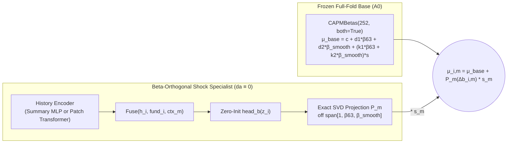

# Q3 v4 Plan: Isolating the Beta-Orthogonal Shock Specialist (`db`)

## 1. Motivation: What the Saved `v3` Predictions Actually Showed

In `v3` ([`encoder/fedenc/v3.py`](../../encoder/fedenc/v3.py) and [docs/encoder/q3-v3-results.md](q3-v3-results.md)), we anchored models on the two-beta CAPM (`A0 = CAPMBetas(252, both=True)`) and projected both the drift correction $\Delta a$ (`da`) and the shock-sensitivity correction $\Delta b$ (`db`) off the within-meeting column space of $B_m = [\mathbf{1}, \beta_{63}, \beta_{\text{smooth}}]$.

When [docs/encoder/q3-v3-results.md](q3-v3-results.md) evaluated the **combined** correction $\Delta \mu = \Delta a + \Delta b \cdot s$ across all 161 development test meetings, it appeared that the corrections added almost nothing (`A1 vs own base: +0.0000`, `A3 vs own base: -0.0008`, combined disagreement slopes `0.50–0.82`). Yet on the 10 meetings with $|s| \ge 5\text{ bp}$, both beta-projected models (`A1` and `A3`) beat their base with 95% bootstrap intervals excluding zero (`-0.018` and `-0.014`), whereas the unprojected `A2` degraded (`+0.013`).

To understand why, we decomposed the saved `v3` prediction tables (`predictions.csv`) into their two exact orthogonal pieces inside each meeting:
$$\Delta a_{i,m} = P_m(\hat{a}_{i,m}), \qquad \Delta b_{i,m} = P_m(\hat{b}_{i,m})$$
and scored $\mu_{\text{base}} + \Delta a$ (`a_only`) and $\mu_{\text{base}} + \Delta b \cdot s$ (`b_only`) separately against both their own 85% inner-training base (`A0_inner`, MSE `5.9330`) and the full-fold two-beta base (`A0`, MSE `5.9024`):

| Saved v3 Arm | Variance Share in `da` vs `db*s` | Slope of `A0` Miss on `da` | Slope of `A0` Miss on `db*s` | `da` MSE Diff vs Base (All 161) | `db*s` MSE Diff vs Base (All 161) | `db*s` MSE Diff (`\|s\| >= 2.5bp`, 42) | `db*s` MSE Diff (`\|s\| >= 5.0bp`, 10) |
| :--- | :---: | :---: | :---: | :---: | :---: | :---: | :---: |
| **A1** (Summary MLP, projected) | **86.7% `da`** / 13.3% `db*s` | `+0.29` | **`+1.89`** | `+0.00070` (hurts) | `-0.00070` (helps) | `-0.00033` | **`-0.01373`** |
| **A2** (Transformer, centered) | **61.0% `da`** / 39.0% `db*s` | `+0.44` | `+1.24` | `+0.00008` (hurts) | `-0.00068` (helps) | `-0.00095` | `-0.00313` |
| **A3** (Transformer, projected) | **45.2% `da`** / 54.8% `db*s` | `+0.19` | **`+1.43`** | `+0.00034` (hurts) | **`-0.00123`** (helps) | **`-0.00247`** | **`-0.01194`** |
| **R0** (Ridge, centered) | **82.9% `da`** / 17.1% `db*s` | `+0.30` | `+0.40` | `+0.00284` (hurts) | `+0.00032` | — | — |

### Four Concrete Lessons from the `v3` Decomposition

1. **Why `da` Helped in `v2` Needed to Be Reversed in `v3`:**
   - In **v2**, the base was the 1-beta `capm_pooled`. Its drift $a$ lacked the 252-day smoothed beta (`beta_smooth`), so the neural networks achieved a `-0.015` MSE gain by using `da` to learn `beta_smooth` (and `v2_b_only` failed because the 1-beta drift was left broken).
   - In **v3**, the base is **already** the two-beta CAPM (`capm_beta_both`), and all corrections are projected off $\text{span}[\mathbf{1}, \beta_{63}, \beta_{\text{smooth}}]$. Once two-beta smoothing is in the base, **there is no predictable non-beta drift `da` left on unshocked meetings** (`slope(da) = +0.19` to `+0.30`). Every arm's `da` hurt out-of-sample MSE (`+0.00034` to `+0.00284`).

2. **Leaving `da` Active Poisoned Training, Early Stopping, and Ridge Tuning:**
   - On 119 of the 161 development test meetings (74%), the Fed surprise is small ($|s| < 2.5\text{ bp}$), so $\Delta b \cdot s \approx 0$ and the prediction difference is almost entirely $\Delta a$.
   - Because `da` accounted for **45% to 87% of the correction variance** and was pure overfitting noise on quiet meetings, inner-validation MSE started rising after just **3.9 epochs in `A1`** and **8.2 epochs in `A3`**, stopping training prematurely and diluting the deployed predictions on quiet days.
   - In [`ResidualRidge`](../../encoder/fedenc/v3.py#L258-L350) (`R0–R2`), the drift weights `w_a` (multiplying `Zc`) and shock weights `w_b` (multiplying `Zc * s`) were forced to share a **single scalar ridge penalty `alpha`**. Because `Zc` has $\sim 5\times$ the variance of `Zc * s` and overfits immediately, inner validation selected `alpha` to suppress `w_a`, crushing `w_b`.

3. **The Beta-Projected `db` Learned a Coherent Economic Signal—And the Transformer Beat the MLP on `db * s`:**
   - Across all 161 meetings, `A3`'s `db * s` has a slope of **`+1.43`** against `A0`'s residual (`+1.89` for `A1`), improving MSE by **`-0.00123`** overall (`-0.00070` for `A1`), **`-0.00247`** on the 42 meetings with $|s| \ge 2.5\text{ bp}$ (`-0.00033` for `A1`), and **`-0.01194`** on the 10 meetings with $|s| \ge 5\text{ bp}$.
   - Even though `A1` (Summary MLP) and `A3` (Patch Transformer) have different architectures, their projected `db` predictions correlate at **`+0.607`**.
   - Inspecting the cross-sectional correlations between `A3`'s projected `db` and firm characteristics reveals what the projected branch learned once the $\beta$ span was blocked:
     - **Cash holdings (`cash`):** `+0.388` (`A1`: `+0.209`)
     - **Relative 252-day return (`ret_rel_mean_252`):** `+0.221` (`A1`: `+0.179`)
     - **Firm size (`log_size`):** `+0.214` (`A1`: `+0.142`)
     - **Book-to-market (`book_to_market`):** `-0.208` (`A1`: `-0.178`)
     - **Total leverage (`leverage`):** `-0.182` (`A1`: `-0.065`)
     - **Relative 252-day drawdown (`ret_rel_drawdown_252`):** `-0.171` (`A1`: `-0.081`)
     - **Compounded max drawdown (`max_drawdown`):** `-0.151` (`A1`: `-0.092`)

4. **The `+0.0306` Inner-Base Handicap in `V3Arm.fit`:**
   - To prevent inner-validation contamination, [`V3Arm.fit`](../../encoder/fedenc/v3.py#L162-L163) fit `self.base` (`CAPMBetas(252, both=True)`) on the first 85% of each training fold (`inner`) and deployed that 85% base without refitting on the full training fold (`5.9330` vs. `A0`'s `5.9024`).
   - By contrast, [`ResidualRidge.fit`](../../encoder/fedenc/v3.py#L337) used the 85%/15% split to select `alpha_` and then refit `self.base` and the correction on 100% of the training fold (`5.9068`).

---

## 2. Core Design of Q3 v4 (`encoder/fedenc/v4.py`)

Q3 v4 is designed around one central principle: **keep the two-beta CAPM drift intact ($\Delta a \equiv 0$), isolate the beta-orthogonal shock-sensitivity specialist $P_m(\Delta b)$, fix the 85%-base handicap via a clean two-stage refit, and test whether sharper corporate debt-repricing features and market-invariant pretraining strengthen $P_m(\Delta b)$.**

### 2.1 Pillar 1: Pure Shock-Sensitivity Specialist ($\Delta a \equiv 0$)

For every meeting $m$, let $Q_m \in \mathbb{R}^{N_m \times r_m}$ ($r_m \le 3$) be the rank-aware SVD orthonormal basis for $\text{span}[\mathbf{1}, \beta_{63}, \beta_{\text{smooth}}]$ on the pre-event eligible firm universe, and let $P_m v = v - Q_m (Q_m^\top v)$.

The v4 model predicts:
$$\mu_{i,m} = \mu^{\text{base}}_{i,m} + \Delta b_{i,m} \cdot s_m, \qquad \Delta b_m = P_m\big(\text{head}_b(z_m)\big), \qquad \Delta a_m \equiv 0$$

**Why setting $\Delta a_m \equiv 0$ on top of `capm_beta_both` changes the optimization geometry:**
1. **Structural protection on small-surprise meetings:** On any meeting where $s_m = 0$, $\Delta b_{i,m} \cdot s_m = 0$ identically, so the model reproduces `A0` with zero noise injection.
2. **Natural $s_m^2$ gradient & validation weighting without changing the estimand:** For residual $e_{i,m} = y_{i,m} - \mu^{\text{base}}_{i,m}$, the per-meeting deployed squared error is:
   $$\frac{1}{N_m} \| e_m - \Delta b_m s_m \|_2^2 = \frac{1}{N_m} \| e_m \|_2^2 - \frac{2 s_m}{N_m} \langle P_m e_m, \Delta b_m \rangle + \frac{s_m^2}{N_m} \| \Delta b_m \|_2^2$$
   Notice that the gradient with respect to $\Delta b_m$ is proportional to $s_m (s_m \Delta b_m - P_m e_m)$, and the validation loss difference relative to the base is zero whenever $s_m = 0$. Early stopping on the inner validation block therefore selects checkpoints **exclusively** on whether $\Delta b_m$ improves predictions on shock meetings, while still optimizing the exact raw-return conditional-mean MSE!

### 2.2 Pillar 2: Two-Stage Inner Validation $\to$ Full-Fold Refit Protocol

To satisfy Finding 1 of [docs/reports/encoder-review-2026-10-17.md](../reports/encoder-review-2026-10-17.md) (no inner-validation contamination during checkpoint selection) **without** paying the `+0.0306` MSE penalty of leaving the final 15% of meetings out of the deployed base:

1. **Stage 1 — Inner Checkpoint Selection (Strictly Isolated):**
   - Split the outer training panel $P_{\text{outer}}$ chronologically into the first 85% of meetings ($P_{\text{inner}}$) and the final 15% of meetings ($P_{\text{val}}$).
   - Fit `base_inner = CAPMBetas(252, both=True)` and `scaler_inner` on $P_{\text{inner}}$ only. Changing labels in $P_{\text{val}}$ has zero effect on `base_inner`, `scaler_inner`, or the inner training residuals $e_{\text{inner}}$.
   - For each ensemble member $j \in \{0, \dots, M-1\}$ with seed `member_seed = seed * 100 + j`, initialize the network (with `head_b` zero-initialized so epoch $0$ equals `base_inner` exactly) and train for up to `max_epochs = 40` (`patience = 10`) on $P_{\text{inner}}$, evaluating the deployed MSE on $P_{\text{val}}$ after each epoch.
   - Record the selected epoch $E^*_j \in \{0, \dots, 40\}$ that minimizes deployed validation MSE on $P_{\text{val}}$.
   - Also compute an optional scalar shrinkage multiplier $\gamma^* \in [0, 1]$ on $P_{\text{val}}$ from the member-averaged validation predictions:
     $$\gamma^* = \text{clip}\left(\frac{\sum_{m \in P_{\text{val}}} \frac{1}{N_m} \langle e_{m,\text{val}},\; \overline{\Delta b}_{m,\text{val}} s_m \rangle}{\sum_{m \in P_{\text{val}}} \frac{1}{N_m} \| \overline{\Delta b}_{m,\text{val}} s_m \|_2^2 + 10^{-12}},\; 0.0,\; 1.0\right)$$
2. **Stage 2 — Full-Fold Refit at Fixed Stopping Budget (`refit=True`, with `refit=False` kept as a matched control):**
   - Fit `self.base = CAPMBetas(252, both=True)` and `self.scaler` on 100% of $P_{\text{outer}}$ (so at $E^*_j = 0$, the model is **identical** to `A0`, scoring `5.9024`).
   - For each member $j$, re-seed with the exact same `member_seed`, initialize the model (zero-init `head_b`), and train on $P_{\text{outer}}$ against $e_{\text{outer}} = y - \mu_{\text{base, outer}}$ for **exactly $E^*_j$ epochs** (if $E^*_j = 0$, no optimizer steps are taken).
   - Scale the number of batches per epoch or learning-rate steps consistently: since `meetings_per_batch = 4`, each epoch on $P_{\text{outer}}$ takes `ceil(N_outer / 4)` steps ($\sim 17\%$ more steps than on $P_{\text{inner}}$), or we can match exact optimizer step counts $S^*_j = E^*_j \cdot \lceil N_{\text{inner}} / 4 \rceil$. (We will lock **exact optimizer step count $S^*_j$** so the total gradient budget in Stage 2 matches Stage 1 to the step.)

### 2.3 Pillar 3: Point-in-Time Corporate Refinancing & Duration Channels (`corp_features`)

In `v3`, `A3`'s projected `db` relied heavily on `cash` (`+0.388`), `book_to_market` (`-0.208`), and `leverage` (`-0.182`). However, [`core/fedcore/q3/real.py`](../../core/fedcore/q3/real.py) currently collapses `dlcq` (short-term debt due in $\le 1$ year) and `dlttq` (long-term debt) into a single `leverage` ratio and ignores operating cash flow (`oibdpq`) and sales (`saleq`), even though all of those columns are already present in `comp_fundq` (`core/data/raw/wrds/comp_fundq.parquet`).

Without modifying `Q3Panel`'s core contract or rebuilding cached panels, an encoder-local feature builder (`fedenc.v4.build_corp_features(panel)`) will join the **point-in-time** quarterly accounting ratios (`rdq < meeting`, stale after `365` days, matching `real.py`'s exact `merge_asof` rules) and jointly observed trailing rate sensitivity:

1. **Short-Term Debt Share (`st_debt_share`):**
   $$\text{st\_debt\_share}_{i,m} = \frac{\text{dlcq}_{i,m}}{\text{dlcq}_{i,m} + \text{dlttq}_{i,m}}$$
   - Defined when `dlcq >= 0`, `dlttq >= 0`, and `dlcq + dlttq > 0`; set to `0.0` when a firm has verified zero total debt (`dlcq == 0` and `dlttq == 0`); `NaN` when either debt item is missing or stale.
   - **Economic mechanism:** Measures the fraction of debt maturing within 12 months that must be rolled over at the new Fed funds / short-term rate (the refinancing wall).
2. **Net Debt to Operating Cash Flow (`net_debt_oibdp`):**
   $$\text{net\_debt\_oibdp}_{i,m} = \frac{\text{dlcq}_{i,m} + \text{dlttq}_{i,m} - \text{cheq}_{i,m}}{4 \cdot \max(\text{oibdpq}_{i,m}, \text{atq}_{i,m} \times 0.01)}$$
   - Preserves `NaN` whenever `dlcq`, `dlttq`, `cheq`, `oibdpq`, or `atq` is missing/stale.
   - **Economic mechanism:** Separates high-leverage firms with ample cash flow and liquidity from firms whose net debt is large relative to operating earnings.
3. **Operating Cash-Flow Yield / Inverse Duration (`ocf_yield`):**
   $$\text{ocf\_yield}_{i,m} = \frac{4 \cdot \text{oibdpq}_{i,m}}{\text{mktcap}_{i,m}}$$
   - Where $\text{mktcap}_{i,m} = |\text{prccq}_{i,m}| \cdot \text{cshoq}_{i,m}$ from the point-in-time quarter (or prior-day CRSP market cap), `NaN` if missing/non-positive.
   - **Economic mechanism:** High current operating cash-flow yield implies short equity duration; low/negative operating cash-flow yield implies long equity duration.
4. **Jointly Observed 63-Day Rate Beta (`rate_beta63`):**
   - Trailing 63-day regression slope of firm excess return (`ret_rel`) on daily 1-year Treasury yield changes ($\Delta y_{1\text{y}, t}$ from `treasury_1y`), computed **strictly over days where both the firm return and $\Delta y_{1\text{y}, t}$ are observed and finite** (minimum 20 jointly observed days; `NaN` otherwise, never zero-filling missing yield changes).
   - **Masking:** Every appended feature column carries its own explicit boolean observation mask `fundamentals_mask[:, j]` (satisfying Review Fix 4: per-feature missingness mask rather than all-or-nothing row masking).

### 2.4 Pillar 4: Market-Loading-Invariant Pretraining (`pretrain_invariance.py`)

Why did `A3` (Patch Transformer) outperform `A1` (Summary MLP) on `db * s` (`-0.00123` vs. `-0.00070` overall; `-0.00247` vs. `-0.00033` on $|s| \ge 2.5\text{ bp}$)? Because the transformer's `db` captured relative drawdown and relative return path features (`ret_rel_drawdown_252`, `max_drawdown`) more strongly than the summary MLP.

However, training the transformer from scratch on only $N_{\text{train}} \in [60, 205]$ meetings where gradient updates are weighted by $s_m^2$ means the encoder only receives strong supervision from the handful of historical meetings with large $|s_m|$.

Following [docs/encoder/q3-v3-roadmap_a.md §3](q3-v3-roadmap_a.md#L150-L224), we test **Market-Loading-Invariant Self-Supervised Pretraining**:
- **Corpus:** Non-overlapping (or stride-21) 252-day firm history windows ending strictly before each fold's inner validation cutoff (or a single pre-1998 / expanding historical corpus with strict chronological cutoff before the test fold). To keep compute fast and leak-free on walk-forward folds, we use the pre-event 252-day history windows of the training panel itself ($P_{\text{inner}}$ during Stage 1, $P_{\text{outer}}$ during Stage 2)—so **zero external dates or future windows can ever leak**.
- **Paired Market-Beta Perturbation Views:**
  For each firm history window $i$ with observed daily returns $r_{i,t}$ and market excess returns $r_{\text{mkt}, t} = r_{i,t} - r_{\text{rel}, i, t}$:
  - Draw $\delta_1, \delta_2 \sim \text{Uniform}[-0.25, +0.25]$ independently.
  - Construct perturbed return series $r^{(v)}_{i,t} = r_{i,t} + \delta_v \, r_{\text{mkt}, t}$ for $v \in \{1, 2\}$ on observed days (`mask == True`).
  - **Exact channel recomputation:**
    - Channel 0 (`ret`): $r^{(v)}_{i,t}$
    - Channel 1 (`dlogvol`): unchanged (volume is invariant to return perturbation)
    - Channel 2 (`rvol21`): recomputed trailing 21-day population std of $r^{(v)}_{i,t}$ on observed days
    - Channel 3 (`ret_rel`): unchanged ($r^{(v)}_{i,t} - r_{\text{mkt}, t}$ with the market component removed, or if `ret_rel` is relative to market, shifting $\beta$ by $\delta_v$ shifts $r_{i,t} - r_{\text{mkt}, t}$ by $\delta_v r_{\text{mkt}, t}$! Note: in `real.py`, `ret_rel = ret - mkt`, which assumes $\beta = 1$, NOT $\text{ret} - \beta \cdot \text{mkt}$! Therefore, adding $\delta_v r_{\text{mkt}, t}$ to both `ret` and `ret_rel` simulates a firm whose true market $\beta$ is higher by $\delta_v$ across all channels: `ret` shifts by $+\delta_v r_{\text{mkt}, t}$, `ret_rel` shifts by $+\delta_v r_{\text{mkt}, t}$, `rvol21` is recomputed from $r^{(v)}_{i,t}$, and `beta63` shifts by $+\delta_v$ on every observed day!).
    - Look how clean that mathematical identity is:
      Because $\text{Cov}(r_i + \delta r_{\text{mkt}}, r_{\text{mkt}}) / \text{Var}(r_{\text{mkt}}) = \beta_{i,63} + \delta$, a perturbation of $+\delta \, r_{\text{mkt}, t}$ to firm $i$'s daily returns **shifts `beta63` by exactly $+\delta$**, shifts `ret` and `ret_rel` by $+\delta \, r_{\text{mkt}, t}$, and updates `rvol21` in closed form on the 252-day tensor without needing any warm-up days prior to $t=0$!
- **VICReg Objective:**
  Pass both views through `PatchTransformerEncoder` ($h^{(1)}, h^{(2)} \in \mathbb{R}^{B \times 64}$) and a 2-layer projector MLP ($z^{(1)}, z^{(2)} \in \mathbb{R}^{B \times 64}$):
  $$\mathcal{L}_{\text{VICReg}} = 25 \, \mathcal{L}_{\text{sim}}(z^{(1)}, z^{(2)}) + 25 \, \mathcal{L}_{\text{std}}(z^{(1)}, z^{(2)}) + 1 \, \mathcal{L}_{\text{cov}}(z^{(1)}, z^{(2)})$$
  - $\mathcal{L}_{\text{sim}} = \text{MSE}(z^{(1)}, z^{(2)})$ forces the encoder to produce the **exact same embedding** when a firm's market beta is shifted by $\pm 0.25$.
  - $\mathcal{L}_{\text{std}} = \frac{1}{2d} \sum_{k=1}^d \left(\max(0, 1 - \sqrt{\text{Var}(z^{(1)}_{\cdot, k}) + \epsilon}) + \max(0, 1 - \sqrt{\text{Var}(z^{(2)}_{\cdot, k}) + \epsilon})\right)$ prevents collapse.
  - $\mathcal{L}_{\text{cov}}$ penalizes off-diagonal covariance across the $d$ embedding dimensions.
- **Matched Control (`vicreg_mask_ctrl`):**
  To verify whether any gain comes from **market-beta invariance** vs. generic VICReg pretraining, a matched control applies VICReg with random 15% patch masking (`delta_1 = delta_2 = 0`).

---

## 3. Pre-Stated Experimental Arms (`B0`–`B6`)

All arms are evaluated on the exact same 161 development test meetings (through `2021-12-31`, `min_train=60, test_size=16`, S&P 500 universe, raw day-0 returns, 3 seeds $\times$ 3 members for neural arms). `2022–2025` is untouched.

| Arm | Base Fit | $\Delta a$ | $\Delta b$ Basis | Encoder / Model | Inputs | Specific Hypothesis Tested |
| :--- | :--- | :---: | :---: | :--- | :--- | :--- |
| **`B0`** (`A0`) | 100% fold | `0` | — | `CAPMBetas(252, both=True)` | `beta63, beta_smooth` | Two-beta CAPM reference (`5.9024`) |
| **`B1_inner`** | 85% inner | `0` | Projected off `[1, b63, bw]` | Patch Transformer (`da=0`, no refit) | Base 5 channels + 6 fund | **Control vs `A3` (`5.9322`) and `A0_inner` (`5.9330`):** Does setting `da=0` during training & early stopping improve on `A3` against the exact same 85% base? |
| **`B1`** (`v4_mlp_b`) | 100% refit | `0` | Projected off `[1, b63, bw]` | Summary MLP (`da=0`, step-matched refit) | Summary features + 6 fund | Does a projected `b`-only MLP with full-fold base refit beat `B0`? |
| **`B2`** (`v4_tf_b`) | 100% refit | `0` | Projected off `[1, b63, bw]` | Patch Transformer (`da=0`, step-matched refit) | Base 5 channels + 6 fund | Does sequence encoding beat `B1` (`v4_mlp_b`) and `B0` once `da` noise and the 85%-base handicap are removed? |
| **`B3`** (`v4_ridge_b`) | 100% refit | `0` | Projected off `[1, b63, bw]` | CPU Ridge (`w_a=0`, $\alpha_b$ from inner val) | Summary features + 6 fund | Does `b`-only Ridge beat `R0` (`5.9068`) and `B0` (`5.9024`) once `w_a` is zeroed out? |
| **`B4`** (`v4_ridge_corp`) | 100% refit | `0` | Projected off `[1, b63, bw]` | CPU Ridge (`w_a=0`, $\alpha_b$ from inner val) | `B3` + `st_debt_share`, `net_debt_oibdp`, `ocf_yield`, `rate_beta63` | Do the point-in-time corporate debt-maturity & duration channels improve linear `db`? |
| **`B5`** (`v4_tf_corp`) | 100% refit | `0` | Projected off `[1, b63, bw]` | Patch Transformer (`da=0`, step-matched refit) | `B2` + `st_debt_share`, `net_debt_oibdp`, `ocf_yield`, `rate_beta63` | Do the corporate debt-maturity & duration channels improve the neural transformer's `db`? |
| **`B6`** (`v4_tf_vicreg`) | 100% refit | `0` | Projected off `[1, b63, bw]` | VICReg Market-Invariant Patch Transformer (`da=0`) | Same inputs as `B2` (or `B5` if `B5 > B2`) | Does market-loading-invariant pretraining improve `db` transfer over scratch initialization? |

---

## 4. Pre-Stated Evaluation Metrics & Falsifiable Questions

Because $\Delta a \equiv 0$ in `B1–B6`, every arm's prediction is $\mu_{i,m} = \mu^{\text{base}}_{i,m} + \Delta b_{i,m} s_m$, which is **identical** to $\mu^{\text{base}}_{i,m}$ whenever $s_m = 0$. Therefore, we report both all-meeting metrics and pre-declared shock-magnitude strata (`|s| >= 1bp` [90 meetings], `|s| >= 2.5bp` [42 meetings], `|s| >= 5bp` [10 meetings]), plus the `2001–2003` vs. `2004–2021` era split:

1. **Q1 (Removing `da` noise during training — `B1_inner` vs `A0_inner` and `A3`):**
   - Does training and early-stopping with $\Delta a \equiv 0$ (`B1_inner`) beat its own 85% base (`A0_inner = 5.9330`) and beat `A3` (`5.9322`) across all 161 meetings and on $|s| \ge 2.5\text{ bp}$?
   - How do the selected epochs $E^*$ and the slope of `A0`'s residual on $\Delta b \cdot s$ compare to `A3`'s (`E* = 8.2`, `slope = +1.43`)?
2. **Q2 (Full-fold base refit + beta-orthogonal `db` — `B2` and `B1` vs `B0`):**
   - Does `B2` (Transformer) or `B1` (Summary MLP) beat the full-fold two-beta CAPM `B0` (`5.9024`) across all 161 meetings and on $|s| \ge 2.5\text{ bp}$, with a positive disagreement slope whose meeting-bootstrap 95% CI excludes zero?
   - Is the gain present in `2004–2021` as well as `2001–2003`?
3. **Q3 (Sequence encoder vs. Summary MLP & Ridge on `db` — `B2` vs `B1` and `B3`):**
   - Does `B2` (Patch Transformer) outperform `B1` (Summary MLP) and `B3` (`b`-only Ridge) on matched inputs and projection?
4. **Q4 (Corporate refinancing & duration features — `B4` vs `B3` and `B5` vs `B2`):**
   - Do `st_debt_share`, `net_debt_oibdp`, `ocf_yield`, and `rate_beta63` improve out-of-sample MSE and `db * s` slope in CPU Ridge (`B4 vs B3`) and the Transformer (`B5 vs B2`)?
5. **Q5 (Market-loading-invariant VICReg pretraining — `B6` vs `B2`):**
   - Does initializing the transformer with the beta-perturbation VICReg objective improve held-out Fed-day MSE and `db * s` slope over random initialization (`B2`)? (If `B6` beats `B2`, run the matched patch-masking VICReg control `B6_ctrl` to verify that beta-invariance—not generic VICReg—drove the gain.)

---

## 5. Implementation Checklist & Safeguards

1. **Files to Create / Update:**
   - [`encoder/fedenc/v4.py`](../../encoder/fedenc/v4.py):
     - `V4Arm`: implements $\Delta a \equiv 0$, rank-aware SVD projection $P_m$ off $\text{span}[\mathbf{1}, \beta_{63}, \beta_{\text{smooth}}]$, strict inner-validation isolation (`Stage 1`), and step-matched full-fold refit (`Stage 2`, toggleable via `refit=True/False`).
     - `V4RidgeB`: implements CPU ridge on `Zc * s` with $\Delta a \equiv 0$, projected off $\text{span}[\mathbf{1}, \beta_{63}, \beta_{\text{smooth}}]$, selecting $\alpha_b \in [10^0, 10^8]$ on the inner validation block and refitting on the full training fold.
     - `build_corp_features(panel)`: point-in-time (`rdq < meeting`, $\le 365$ days) construction of `st_debt_share`, `net_debt_oibdp`, `ocf_yield`, and jointly observed `rate_beta63` ($\ge 20$ jointly observed days, preserving `NaN` with per-column `fundamentals_mask`).
     - `pretrain_vicreg_beta_invariant(...)`: self-supervised paired-view market-loading perturbation ($\delta_1, \delta_2 \sim \text{Uniform}[-0.25, +0.25]$) with closed-form exact channel updates (`ret`, `rvol21`, `ret_rel`, `beta63`) and VICReg loss.
     - `score_v4(...)`: reproducible read-only CLI subcommand (`python -m fedenc.v4 score`) that computes all pre-stated comparisons, era splits (`2001–2003`, `2004–2021`), shock-magnitude strata (`|s| >= 1, 2.5, 5bp`), and `db * s` disagreement slopes directly from saved runs (no scratchpad scripts needed).
   - [`encoder/tests/test_v4.py`](../../encoder/tests/test_v4.py):
     - **Inner-validation invariance test:** Changing `target` on inner-validation meetings leaves `base_inner`, `scaler_inner`, and inner-training residuals identical to machine precision.
     - **Exact $\Delta a \equiv 0$ & $s = 0$ invariance test:** On any meeting with $s_m = 0$, `V4Arm(refit=True)` and `V4RidgeB` predictions equal `B0` (`CAPMBetas(252, both=True)`) to `< 1e-12`.
     - **Exact SVD orthogonality test:** Within every meeting, $\Delta b_m^\top \mathbf{1} = 0$, $\Delta b_m^\top \beta_{63,m} = 0$, and $\Delta b_m^\top \beta_{\text{smooth},m} = 0$ to `< 1e-10`, including under collinear beta columns.
     - **Beta-perturbation view consistency test:** Verifies that adding $+\delta \, r_{\text{mkt}, t}$ to observed firm returns shifts trailing `beta63` by exactly $+\delta$ and leaves masked positions untouched.
     - **Corporate feature chronology & missingness test:** Verifies `rdq < meeting`, staleness cutoff, per-column `fundamentals_mask` agreement with `np.isfinite`, and zero lookahead.

2. **Execution Sequence (Once Authorized):**
   - **Step 1 (CPU, ~15 seconds):** Run `B0`, `B3` (`v4_ridge_b`), and `B4` (`v4_ridge_corp`) on CPU to verify `b`-only Ridge and the corporate debt/duration features immediately.
   - **Step 2 (GPU on Vast, ~15 minutes):** Run `B1_inner`, `B1` (`v4_mlp_b`), `B2` (`v4_tf_b`), `B5` (`v4_tf_corp`), and `B6` (`v4_tf_vicreg`), followed by `python -m fedenc.v4 score`.

